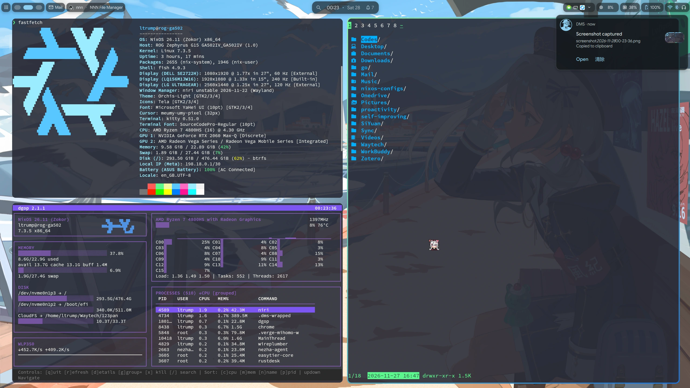
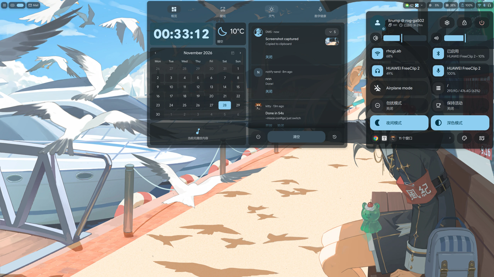

<h2 align="center">:snowflake: LTrump's Nix Config :snowflake:</h2>

  

> This configuration and READMEs in this repo borrows heavily from [ryan4yin/nix-config](https://github.com/ryan4yin/nix-config) and his 
> [cookbook](https://github.com/ryan4yin/nixos-and-flakes-book). Many thanks to his spirit of sharing!

This repository is home to the nix code that builds my systems:
Currently, this repository contains the nix code that builds:

1. NixOS Desktops: NixOS with home-manager, niri, agenix, etc.
2. NixOS Servers: Cloud VPS, Proxmox VE, MicroVMs (Home NUC), etc.

See [./hosts](./hosts) for details of each host.

## Why NixOS & Flakes?

Nix allows for easy-to-manage, collaborative, reproducible deployments. This
means that once something is setup and configured once, it works (almost)
forever. If someone else shares their configuration, anyone else can just use it
(if you really understand what you're copying/refering now).

As for Flakes, refer to
[Introduction to Flakes - NixOS & Nix Flakes Book](https://nixos-and-flakes.thiscute.world/nixos-with-flakes/introduction-to-flakes)

## Components

The Xorg environment (i3wm) has been removed from this configuration.
Below are some of the components used for my daily machine.

|                             | NixOS(Wayland)                                                                                                            |
| --------------------------- | :------------------------------------------------------------------------------------------------------------------------ |
| **Window Manager**          | [Niri][Niri]                                                                                                              |
| **Desktop Shell**           | [Dux-Modular-Shell][DMS]: bar/notifications/launcher/lock screen/control center/power menu/screenshots, one unified shell |
| **Terminal Emulator**       | [Kitty][Kitty]                                                                                                            |
| **Terminal Multiplexer**    | [Zellij][Zellij]                                                                                                          |
| **Shell**                   | [FishShell][fish] + [Starship][Starship]                                                                                  |
| **Editor / IDE**            | [Helix][Helix] + [Neovim][Neovim] ([ayamir/nvimdots][nvimdots])                                                           |
| **Networking**              | [NetworkManager][NetworkManager] + systemd-networkd                                                                       |
| **Input Method**            | [Fcitx5][Fcitx5] with [FlyPY][FlyPY]                                                                                      |
| **System Monitor**          | [Bottom][Bottom] (+ DMS's built-in sysmon)                                                                                |
| **File Manager**            | [nnn][nnn] + [thunar][thunar]                                                                                             |
| **Music Player**            | [LX Music][lx-music-desktop]                                                                                              |
| **Media Player**            | [mpv][mpv], [wiliwili][wiliwili]                                                                                          |
| **Image Viewer**            | [vimiv][vimiv], [imv][imv]                                                                                                |
| **Screenshot Software**     | Native DMS capture: region / fullscreen / scroll                                                                          |
| **Screen Recording**        | [OBS][OBS]                                                                                                                |
| **Fonts**                   | [Nerd fonts][Nerd fonts]                                                                                                  |
| **Filesystem**              | [Btrfs][Btrfs] subvolumes, clean '/' every boot for impermance                                                            |

## Some configurations in this repo may helpful

- DarkMode - DMS + [darkman](./home/gui/appearance/darkman.nix) + [dconf](./home/gui/appearance/dconf.nix) + [xsettingsd](./home/gui/appearance/xsettingsd.nix)
- [WeMeet (worked with wayland)](./home/gui/daily/wemeet/)
- [Fcitx5 (with flypy)](./home/gui/fcitx5/)
- Terminal File Picker - [NNN](./home/gui/nnn/) + [xdg-desktop-portal-termfilechooser](./home/gui/xdg-portals/)
- [Mail Workflow](./home/tui/mail/) - [aerc (reader)](./home/tui/mail/aerc/) + [offlineimap (imap sync)](./home/tui/mail/offlineimap.nix) + [imapnotify (monitor)](./home/tui/mail/imapnotify.nix)
- [AnimeBoot (GRUB + plymouth)](./modules/nixos/desktop/animeboot/)
- [SJTU VPN](./modules/nixos/desktop/vpn/)
- [SD-WAN (easytier + tailscale)](./modules/nixos/server/sdwan.nix)

## Niri + Dux Shell

## Neovim

See [./home/tui/editors/neovim/](./home/tui/editors/neovim/) for details.

## Helix

See [./home/core/editors.nix](./home/core/editors.nix) for details.

## Secrets Management

See [./secrets](./secrets) for details.

## Folder Structure

- `modules/` - common NixOS modules
  - `base/` - common modules
  - `nixos/` - NixOS modules
    - `base/` - modules for all hosts
    - `desktop/` - modules for desktop hosts
    - `server/` - optional modules
  - `options.nix` - my custom NixOS module options
- `home` - common Home-Manager modules
  - `core/` - hm modules for all hosts
  - `tui/` - tui-related hm modules, mainly for remote development
  - `gui/` - hm modules for desktop hosts
    - `daily/` - daily-use applications
    - `dux-shell/` - DMS (dux-shell) settings, session and plugins
  - `options.nix` - my custom hm module options
- `hosts/<name>/` and `hosts/microvms/<name>/` - hosts-specific modules
  - `modules/` - NixOS modules
  - `home/` - Home-Manager modules
- `packages/` - custom packages
- `overlays/` - nixpkgs overlays
- `vars/` - my variables (user info, networks, etc)
- `outputs/` - flake outputs definitions. see [./outputs](./outputs) for details
- `secrets/` - secrets managed by agenix. see [./secrets](./secrets) for details
- `flake.nix` - flake entry

## References

[Niri]: https://github.com/YaLTeR/niri
[Zellij]: https://github.com/zellij-org/zellij
[Kitty]: https://github.com/kovidgoyal/kitty
[NetworkManager]: https://wiki.gnome.org/Projects/NetworkManager
[Fcitx5]: https://github.com/fcitx/fcitx5
[nnn]: https://github.com/jarun/nnn
[thunar]: https://gitlab.xfce.org/xfce/thunar
[fish]: https://github.com/fish-shell/fish-shell
[Starship]: https://github.com/starship/starship
[lx-music-desktop]: https://github.com/lyswhut/lx-music-desktop
[mpv]: https://github.com/mpv-player/mpv
[wiliwili]: https://github.com/xfangfang/wiliwili
[Helix]: https://github.com/helix-editor/helix
[Neovim]: https://github.com/neovim/neovim
[nvimdots]: https://github.com/ayamir/nvimdots/
[Nerd fonts]: https://github.com/ryanoasis/nerd-fonts
[vimiv]: https://github.com/karlch/vimiv
[imv]: https://sr.ht/~exec64/imv/
[OBS]: https://obsproject.com
[Btrfs]: https://btrfs.readthedocs.io
[Bottom]: https://github.com/ClementTsang/bottom
[FlyPY]: https://www.flypy.com/
[DMS]: https://github.com/duxlabs-dev/dux-shell
